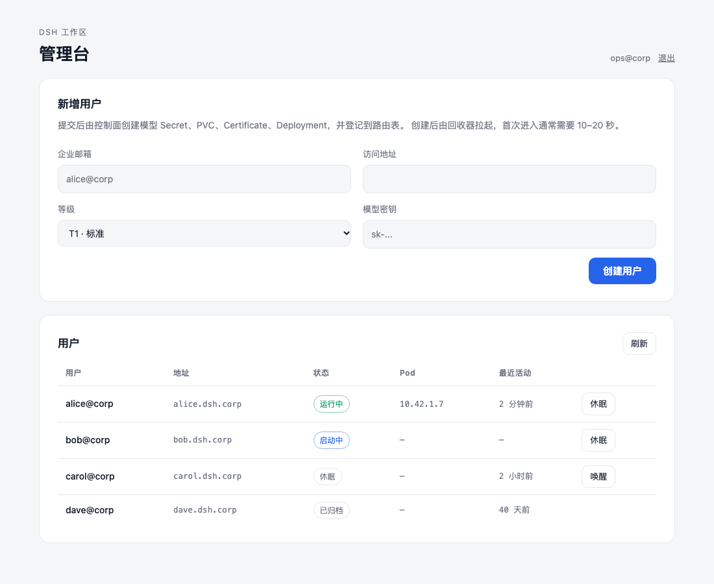

# 新增一个用户（当前实现）

> 一句话：管理员在 `/_dsh/admin` 填一次表单（或跑一次 `provision.py`），**控制面**负责创建
> Secret / PVC / Certificate / Deployment 并登记到 `dsh_users`。开通仍是显式动作，
> 不是「首次登录自动创建」。



## 0. 前置（每集群一次，已就绪可跳过）

| 依赖 | 检查 |
|---|---|
| `dsh-system` / `dsh-users` 命名空间 | `kubectl get ns` |
| PostgreSQL + `dsh_users` 表 | `kubectl -n dsh-system exec dsh-postgres-0 -- psql -U dsh -d dsh -c '\d dsh_users'` |
| `dsh-control` 在集群内运行 | 不在集群时开通接口返回 503（拿不到 ServiceAccount 凭据） |
| control 的 RBAC 含 secrets 写权限 | `kubectl -n dsh-users auth can-i create secrets --as=system:serviceaccount:dsh-system:dsh-control` |
| control 的开通配置 | `kubectl -n dsh-system get deploy dsh-control -o jsonpath='{.spec.template.spec.containers[0].env}'`，确认 `DSH_IMAGE` / `DSH_STORAGE_CLASS` / `DSH_RUNTIME_CLASS` / `DSH_BASE_DOMAIN` |
| router 的管理台配置 | 清单里的 `ADMIN_TOKEN`（来自 `dsh-control-auth`）与 `ADMIN_SUBJECTS`（逗号分隔白名单） |
| 通配 DNS + 通配证书 | `*.dsh.corp` 指向网关，`dsh-wildcard-tls` 已签发 |
| Kata / StorageClass / Issuer | `kubectl get runtimeclass kata-clh-runtime-rs`、`sc dsh-rbd`、`clusterissuer dsh-internal-ca` |

`ADMIN_SUBJECTS` 为空时管理台整体 404（不是 403），这是刻意的默认关闭。

## 1. 用管理台（推荐）

1. 打开 `https://<任一用户子域>/_dsh/admin`，例如 `https://alice.dsh.corp/_dsh/admin`；
2. 未登录会先走 SSO，登录后 `subject` 必须在 `ADMIN_SUBJECTS` 里；
3. 填企业邮箱（访问地址自动派生为 `<slug>.<DSH_BASE_DOMAIN>`）、模型密钥、等级；
4. 点「创建用户」，等 10–20 秒；列表里状态从「启动中」变成「运行中」；
5. 后续可在列表里「休眠 / 唤醒」，也可以直接让用户访问 `https://<slug>.dsh.corp`。

页面只提交 `subject` / `tier` / `modelToken` 三个字段；镜像、StorageClass、RuntimeClass、
Issuer、命名空间全部由控制面的环境变量决定，避免管理员填错。

## 2. 用 CLI（等价路径）

`provision.py` 现在只是一个 API 客户端，和管理台走同一条 `/internal/provision`：

```sh
kubectl -n dsh-system port-forward svc/dsh-control 8080:8080 &
ADMIN_TOKEN=$(kubectl -n dsh-system get secret dsh-control-auth -o jsonpath='{.data.admin-token}' | base64 -d)

ADMIN_TOKEN="$ADMIN_TOKEN" ./provision.py bob@corp \
  --tier T1 \
  --model-token 'sk-...' \
  --control-url http://127.0.0.1:8080
```

`--dry-run` 只打印请求体（密钥打码），不发送。

## 3. 背后发生什么

1. router 校验 `dsh_sess` 与 `ADMIN_SUBJECTS`，带管理员令牌调用 control 的 `/internal/provision`；
2. control 校验邮箱格式、派生 `slug`、检查 `handle` 是否被别的 subject 占用；
3. 创建/更新模型 Secret `dsh-model-token-<slug>`（留空密钥时要求它已存在）；
4. 创建 PVC（已存在则**不动**，`spec` 不可变）；
5. 创建 Certificate（DNS + SPIFFE URI SAN）；
6. 创建 Deployment `replicas: 0`（副本数只由 reaper 改）；
7. `UpsertUser` 写 `dsh_users`，`desired_state='running'`；
8. 之后自动：cert-manager 签发 → reaper 拉到 1 → pod `init-home` → `dsh web` → `register` 回填 podIP/token。

## 4. 不需要做的事

- 不建 Secret（控制面建）、不写 YAML、不调 `kubectl apply`；
- 不加 DNS、不签单独证书（通配已覆盖）；
- 不改 Istio / RBAC / NetworkPolicy / 数据库；
- 不重启 router / control / reaper；
- 不重建镜像。

## 5. 常见坑

1. **`ADMIN_SUBJECTS` 没配** → `/_dsh/admin` 直接 404，看起来像路由坏了。
2. **control 不在集群里** → 开通 503；本地调试时开通能力会被自动关闭（日志有 `provisioning disabled`）。
3. **RBAC 少 secrets** → control 写模型 Secret 时拿到 403，页面上会显示 k8s 错误原文。
4. **handle 冲突** → `alice@corp` 与 `alice@other` 都是 `alice`，第二条返回 409。
5. **`--namespace dsh-untrusted` 不成立**：准入策略、NetworkPolicy、RBAC、reaper 的 `NAMESPACE` 都只覆盖 `dsh-users`。
6. **开通即拉起**：登记就是 `desired_state='running'`，reaper 立刻 scale；不是「首次访问才创建」。
7. **subject 必须与 IdP 一致**：控制面、pod 注解、router cookie 三处同一个字符串。
8. **下线没有 API**：control 没有 delete 端点。停用需要手工删 Deployment / PVC / Certificate 和 `dsh_users` 行；
   删 PVC 等于删数据，没有归档实现。

## 6. 停用/回滚

```sh
kubectl -n dsh-users scale deploy/dsh-bob --replicas=0
kubectl -n dsh-users delete deploy/dsh-bob cert/dsh-bob-tls
kubectl -n dsh-users delete pvc/dsh-home-<hash>          # 数据会丢，先确认
kubectl -n dsh-system exec dsh-postgres-0 -- psql -U dsh -d dsh -c "DELETE FROM dsh_users WHERE subject='bob@corp'"
```

只删数据库行而不删 Deployment 会留下孤儿资源；只删 Deployment 而不删行，用户会停在「尚未开通」。
