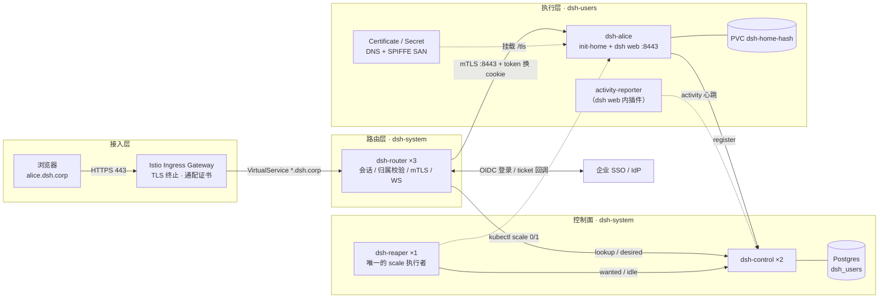
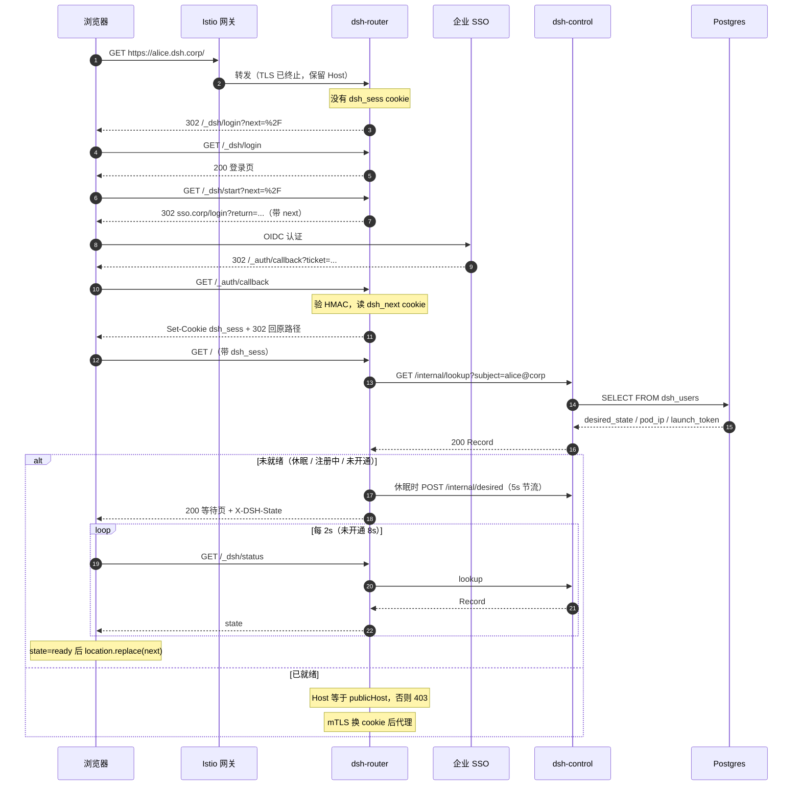
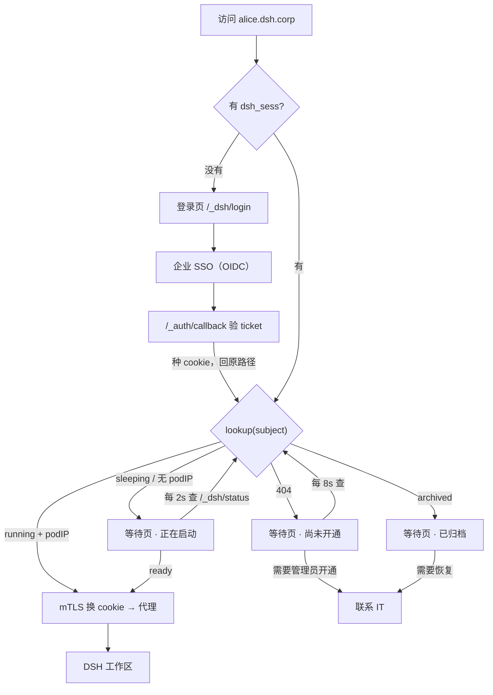
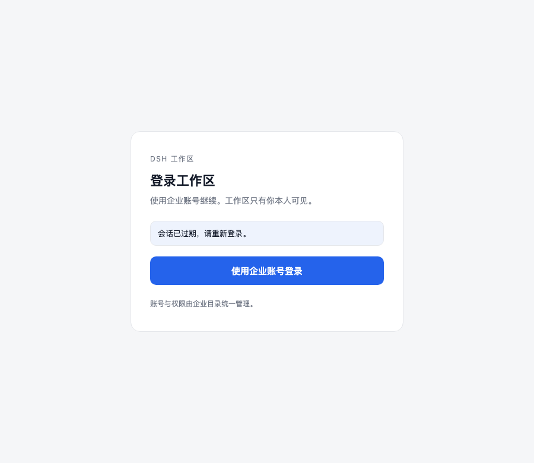
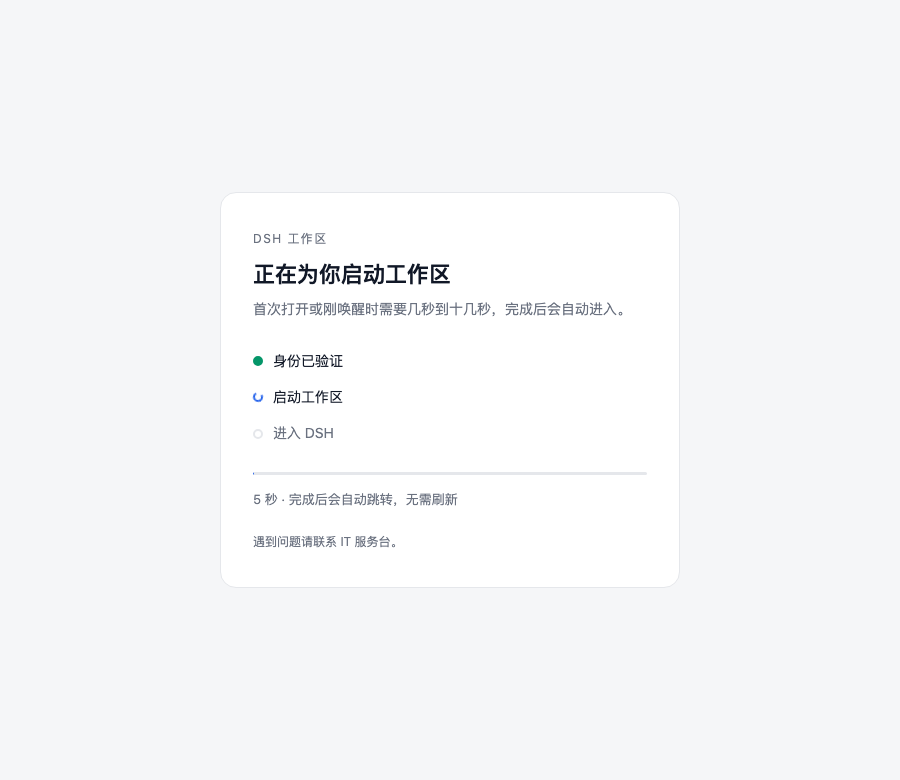
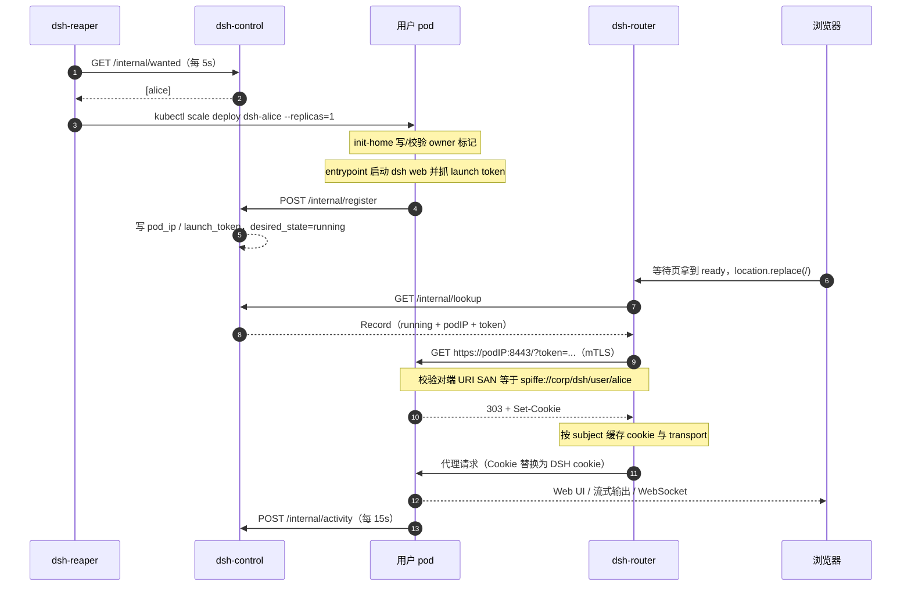
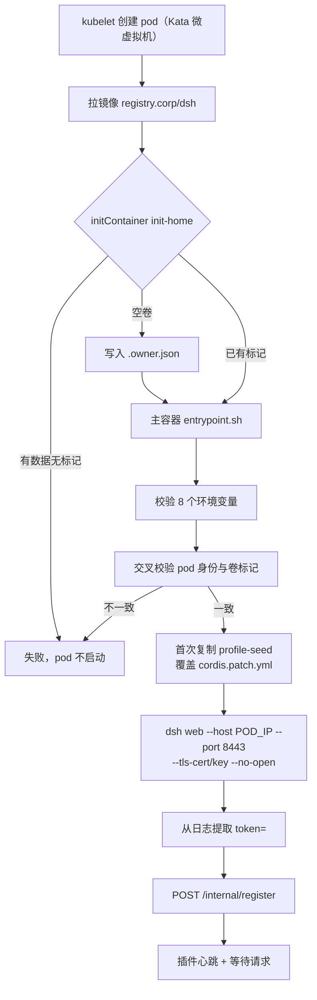
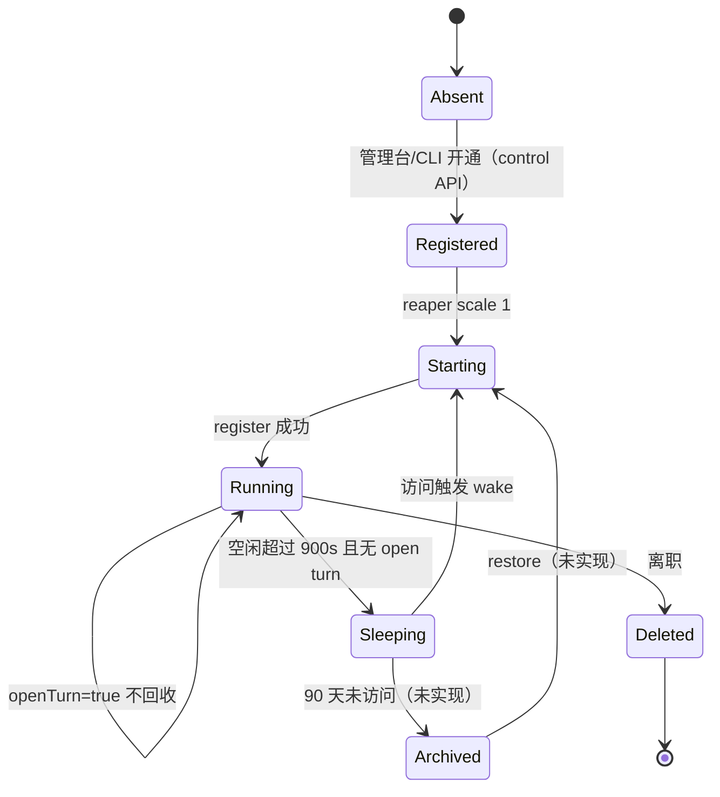

# 从新用户登录到 DSH 服务启动：模块、服务与链路

> 基于仓库当前实现（`provision.py`、`control/`、`router/`、`reaper/`、`image/`、`plugin/` 与 `01..14 *.yaml`）。
> 凡标「设计文档」处指 `dsh-enterprise-deploy-checklist.md`；标「未实现」处表示代码里没有对应回路。

## 0. 一句话结论

**登录不发生在 DSH 里。** DSH 只认 `GET /?token=<launch token>` 换签名 cookie 这一个入口，
所以认证只能在网关做。整条链路是三个独立阶段，靠控制面的一条记录串起来：

1. **网关认证**：Istio + 企业 SSO → router 签发自己的会话 cookie（浏览器只看得到这一层）。
2. **控制面路由/唤醒**：router 用 `subject` 查 `dsh_users`，决定转发到哪个 pod、要不要拉起。
3. **Pod 启动与注册**：pod 内的 `entrypoint.sh` 启动 `dsh web`，把本次的 `podIP + launchToken` 回填控制面。

三者之间唯一的共享事实是 `dsh_users` 表；DSH 进程本身不参与身份判断。

用户侧只看得到两个平台页面——**登录页**与**启动等待页**。它们由 router 内联渲染，
既不依赖 DSH 也不依赖集群外资源，所以工作区还没起来时也能正常显示。

## 1. 参与模块与服务

| # | 模块/服务 | K8s 对象（命名空间） | 职责 | 接口 | 凭据 |
|---|---|---|---|---|---|
| 1 | 企业 SSO / IdP | 外部 | OIDC 登录、校验 `return` 白名单、签发 ticket | `https://sso.corp/login` | — |
| 2 | Istio Ingress Gateway | Deployment（`istio-system`）+ Gateway/VirtualService（`dsh-system`） | TLS 终止、`*.dsh.corp` 分流；`timeout: 0s`、`retries: 0` | 443 → router:8080 | 通配证书 `dsh-wildcard-tls` |
| 3 | **dsh-router** ×3 | Deployment + Service（`dsh-system`） | 会话 cookie、`subject→目标`、Host 一致性、mTLS、用 token 换 DSH cookie、WS 代理 | 8080（入口）/ 8443（出口） | `cookie-key`、`router-token`、客户端证书 |
| 4 | **dsh-control** ×2 | Deployment + Service（`dsh-system`） | 用户注册表 / 活动状态 / 期望状态 API | 8080 | `admin-token`、`router-token`、`register-token` |
| 5 | Postgres | StatefulSet `dsh-postgres-0` + Service | `dsh_users` 持久化（唯一的共享事实） | 5432 | `dsh-postgres-dsn` |
| 6 | **dsh-reaper** ×1 | Deployment（`dsh-system`） | 唯一执行 `scale` 的组件（拉起 / 休眠） | control API + K8s API | `router-token` |
| 7 | 用户 pod `dsh-<slug>` | Deployment（`dsh-users`）+ PVC + Certificate | 运行 `dsh web`；身份交叉校验；启动后注册 | 8443（mTLS） | `register-token`、模型 token、`/tls` |
| 8 | `init-home.sh` | initContainer | 卷 owner 标记（`.owner.json`） | — | — |
| 9 | activity-reporter | DSH 插件（`dsh web` 进程内） | `turn/start`、`turn/end` 心跳上报 | control 8080 | `register-token` |
| 10 | **开通能力**（`control/provision.go` + `router/admin.go`） | control / router 进程内 | 创建 Secret/PVC/Certificate/Deployment 并登记；管理台页面 | `POST /internal/provision`、`/_dsh/admin` | `admin-token`、`ADMIN_SUBJECTS` |
| 11 | 准入/网络/RBAC 策略 | VAP、NetworkPolicy、Role | 禁止挂错卷、默认拒绝、最小权限 | — | — |
| 12 | 平台页面与状态接口 | router 进程内联渲染 | 登录入口、启动进度、就绪轮询 | `/_dsh/*`（8080） | 复用 `dsh_sess` |

初始化依赖（不在请求链路上，但缺了起不来）：cert-manager + `ClusterIssuer dsh-internal-ca`、
Kata `RuntimeClass`、支持 `flock` 的 StorageClass、KVM 节点池与污点容忍。

## 2. 端到端链路

### 阶段 0 · 开通（一次性，管理员/自动化执行）

管理员在 `/_dsh/admin` 提交（或 `provision.py` 调同一个 API），由 **control** 写入四份 K8s 资源 + 一条记录：

- Secret `dsh-model-token-<slug>`（模型凭据）
- PVC `dsh-home-<sha256(user)[:12]>`（RWO，`dsh-rbd`）
- Certificate `dsh-<slug>-tls`：`dnsNames=[publicHost]`、`uris=[spiffe://corp/dsh/user/<user>]`
- Deployment `dsh-<slug>`：`replicas: 0`、`Recreate`、Kata、SA `dsh-workload`（无 RBAC）
- `UpsertUser` → `dsh_users`，`desired_state='running'`

router 只做管理台认证与转发，不持有 K8s 权限；所有 `apply` 都是「先 GET 再 CREATE/PATCH」，重复提交幂等。

准入策略在这一步兜底：pod 的 `dsh.corp/user` / `dsh.corp/home-claim` / 实际 `claimName` 三者必须一致；
PVC 必须带 owner label。

> 注意：`UpsertUser` 直接写 `running`，所以 reaper 下一轮（≤5s）就会把副本拉到 1。
> 「首次访问才拉起」这个回路实际没有实现（见 §5）。

### 阶段 1 · 登录（在网关完成，DSH 不参与）

1. 浏览器 → `https://alice.dsh.corp/` → Istio 443 终止 TLS（通配证书）→ VirtualService → `dsh-router:8080`。
2. router `handleRoute` 读 `dsh_sess`：没有 / 验签失败 / 过期 → 302 到 `/_dsh/login?next=<原路径>`。
   登录页点按钮后经 `/_dsh/start` 才 302 到 SSO；`LOGIN_MODE=direct` 或非浏览器客户端直接跳 SSO。
3. SSO 完成 OIDC，校验 `return` 属于 `*.dsh.corp`，签发 `ticket=subject|exp|hmac`（60s）。
4. 回跳 `/_auth/callback`，router 验 ticket + 读 `dsh_next` cookie → 种 `dsh_sess`
   （HttpOnly / Secure / SameSite=Lax / 12h）→ 302 回原路径（默认 `/`）。

### 阶段 1.5 · 登录页与启动等待页（router 内联）

| 路由 | 方法 | 作用 |
|---|---|---|
| `/_dsh/login?next=&e=` | GET | 登录页；`e` 只接受 `expired` / `logout` / `denied`，用于显示提示 |
| `/_dsh/start?next=` | GET | 校验 `next` 写入 5 分钟的 `dsh_next` cookie，再 302 到 SSO |
| `/_auth/callback` | GET | 验 ticket、读 `dsh_next`、种 `dsh_sess`、跳回原路径 |
| `/_dsh/logout` | POST | 清 cookie（校验 Origin），303 回登录页 |
| `/_dsh/assets/*` | GET | 页面样式与脚本（embed 进二进制的静态文件） |
| `/_dsh/status` | GET | 等待页轮询：`{state, retryAfterMs}`；subject 只从 cookie 取 |

等待页的行为：

- 目标未就绪时 `handleRoute` 不再回 503/502，而是 **200 的 HTML 页**，真实状态放 `X-DSH-State` 头（`Cache-Control: no-store`）。
- 页面每 2s 查 `/_dsh/status`；`not_provisioned` 放慢到 8s；`ready` 后 `location.replace(next)`，用户无需刷新。
- 一次网络抖动不会把「启动中」翻成错误页；只有状态接口明确返回 `error` 才切换。
- 超过 90s 显示「立即重试」，但不会自动放弃轮询。
- 非浏览器客户端（curl / XHR / WebSocket）仍然拿 `503 + Retry-After`，接口语义不变。
- 页面只引用 `/_dsh/assets/` 下的静态资源，CSP 收紧到 `style-src 'self'; script-src 'self'`；
  改 HTML/CSS/JS 只动 `router/web/`，不需要碰 Go。

> 为什么页面回 200 而不是 503：企业代理常把 5xx 的 body 换成自己的错误页。
> 真实状态放在 `X-DSH-State` 里，监控与日志照样能分辨。
>
> 登录页是否多一次点击：`LOGIN_MODE=direct` 可恢复成一键直跳 SSO；
> 默认 `page` 是为了给内部门户、书签和过期会话一个明确的落点。
>
> `next` 不拼进 SSO 的 `return`：不少企业 SSO 的 return 白名单只匹配固定路径，
> 带查询串会被拒。改成同站 host-only 的短时 cookie，回调地址就永远是 `/_auth/callback`。

配置项：

| 变量 | 默认 | 作用 |
|---|---|---|
| `DSH_BRAND` | `DSH 工作区` | 页面品牌名 |
| `LOGIN_MODE` | `page` | `page` 先给登录页；`direct` 直跳 SSO |
| `PUBLIC_SCHEME` | `https` | 拼 SSO `return` 与 `--public-url` |
| `COOKIE_SECURE` | `true` | 会话 cookie 的 Secure 标记 |

### 阶段 2 · 路由决策（由 subject 决定，不由 Host 决定）

`lookup(subject)` → control `/internal/lookup`（Bearer `router-token`）→ Postgres：

| 查询结果 | 浏览器看到 | 接口客户端看到 |
|---|---|---|
| 404 | 「尚未开通」等待页（**不会**自动开通，见 §5） | `503` |
| `desiredState == sleeping` | 节流唤醒（同一用户 5s 一次）→「正在启动」 | `503 + Retry-After: 3` |
| `desiredState == archived` | 「已归档」页，不唤醒 | `503` |
| `running` 但 `podIP` 为空 | 「正在启动」（注册前的空窗，原先是 502） | `503 + Retry-After: 3` |
| `running` 且 `podIP` 就绪 | token 交换 → 代理 | 同左 |
| Host ≠ `publicHost` | `403`（先校验，再判就绪） | `403` |

Host 校验放在「判就绪」之前：否则 Alice 会在 Bob 的启动页面上等一个不属于她的工作区。
这也是防「Alice 用自己的身份进入 `bob.dsh.corp`」的关键——路由目标来自身份，Host 只做一致性比对。

### 阶段 3 · 唤醒与 Pod 启动

reaper 每 5s 拉 `/internal/wanted`（`desired_state=running`），对 `replicas=0` 的 `deploy/dsh-<handle>` 执行 `scale 1`。
随后：

1. 调度到 KVM 节点池（Kata 微虚拟机，`tolerations` 容忍 `dsh.corp/dedicated`）。
2. 从私有 registry 拉镜像（egress 白名单放行 `10.20.0.0/16:443`）。
3. `initContainer init-home`：空卷写 `.owner.json`；已有标记放行；**有数据但无标记 → 失败**（防挂错卷）。
4. 主容器 `entrypoint.sh` 五步（顺序固定）：
   校验环境变量 → 交叉校验 `DSH_USER_ID` 与卷上标记 → 首次复制 profile-seed 并覆盖平台 `cordis.patch.yml`
   → 启动 `dsh web --host $POD_IP --port 8443 --public-url … --trusted-host … --tls-cert/key --no-open`
   → 60s 内从 `/tmp/dsh-web.log` 抓 `token=` → `POST /internal/register`。
5. control `Put()`：写 `pod_ip` / `launch_token` / `principal_uri`，`desired_state='running'`，`last_activity_at=now`。

### 阶段 4 · 建立会话（token 换 cookie）

router 为每个 subject 建一个 mTLS transport（客户端证书 `dsh-router-client`，SNI = `publicHost`，
`VerifyConnection` 比对对端证书 URI SAN == `principalUri`），然后：

- 内部 `GET https://<podIP>:8443/?token=<launchToken>`，`Host: alice.dsh.corp`，不跟随 303，只取 `Set-Cookie`
- 缓存 `cookie + transport`（按 subject）
- 之后每个请求：替换浏览器 Cookie 为 DSH cookie、删 `X-Forwarded-User`、`FlushInterval=-1`（流式）、HTTP/1.1（WebSocket）

### 阶段 5 · 稳态与回收

- 插件每 15s 心跳：`turn/start → openTurn=true`，`turn/end → false`，`lastActivityAt` 取最大值。
- reaper 每 5s 拉 `/internal/idle?olderThanSeconds=900`；缩容前**二次确认**（`openTurn=false` 且 `lastActivityAt` 未变）
  → `scale 0` → `POST /internal/desired {sleeping, clearPod}`（清掉 `pod_ip` / `launch_token`）。
- 下次访问回到阶段 2 的唤醒分支。

## 3. 流程图

### 3.1 分层拓扑

### 3.2 登录、等待与路由决策

### 3.3 页面状态流转

页面实际效果（浅色主题）：

### 3.4 唤醒、Pod 启动、会话建立

### 3.5 Pod 内启动顺序

### 3.6 用户状态机

## 4. 信任链与凭据

| 跳 | 机制 | 凭据 / Secret |
|---|---|---|
| 浏览器 → 网关 | TLS，通配证书 | `dsh-wildcard-tls`（cert-manager） |
| 浏览器 → router | HMAC 会话 cookie，12h | `dsh-router-auth/cookie-key` |
| 浏览器 → router（管理台） | `dsh_sess` + `ADMIN_SUBJECTS` 白名单 | 同上 |
| router → control（开通） | Bearer `admin-token` | `dsh-control-auth/admin-token` |
| 网关 → router | 集群内 HTTP，依赖 Host + NetworkPolicy | — |
| router → pod | **mTLS 双向**：客户端证书 + 对端 URI SAN 校验 | `dsh-router-client-tls`、`dsh-internal-ca-keypair` |
| pod → control | Bearer | `register-token`（`dsh-users` 里的同值副本） |
| router / reaper → control | Bearer | `router-token` |
| provision.py → control | Bearer | `admin-token` |
| pod → 模型网关 | TLS + API key，`baseURL` 走内网 | `dsh-model-token-<slug>` → `DSH_MODEL_TOKEN` |

设计上浏览器**永远看不到** launch token 与 DSH cookie：router 用自己的 cookie 换，代理时替换。
唯一的硬约束是「launch token 不过网」——它等价于该 pod 的完整工具权限。

## 5. 现状差异与坑（按影响排序）

1. **首次登录不会自动开通。** 现在有管理台与 `/internal/provision` 可以一键创建，但开通仍是显式动作：
   没有登记的用户只会看到「尚未开通」等待页，router 不会替他创建资源。要真正自助，
   需要 IdP webhook 或登录回调触发开通。
2. **（已修复）注册空窗曾经返回 502。** 唤醒把 `desired_state` 置为 `running` 后，`pod_ip` 要等注册才有；
   旧逻辑只判断 `desiredState != running`，于是 `dshCookie()` 拼出 `https://:8443/`，用户看到 502。
   现在 `podIP == ""` 一律算 `starting`，由等待页轮询到注册完成。
3. **「开通即拉起」≠「首次访问才拉起」。** `UpsertUser` 写 `desired_state='running'`，
   reaper 立刻 scale 1，与 `14-example-user.yaml` 里「首次访问由回收器拉起」的注释不符；若真按需，
   登记时应写 `sleeping`。
4. **ticket 可重放。** 实现是 `HMAC(subject|exp)`，没有一次性存储（nonce/Redis），
   设计文档 §5.3.4 要求的「一次性 + 绑定 host」还没落地。
5. **router 的 `dshCookies` / `transport` 按 subject 常驻、无失效路径。**
   pod 重启后能继续用是因为 DSH 签名密钥持久化在 PVC 的 `.credentials.yaml`；
   一旦轮换该密钥，必须同时重启 router，否则旧 cookie 全部 401。
6. **文档与实现不一致，需对齐：**
   - checklist §3.3 要求「不在 pod 内终止 TLS」，实现是 pod 内 TLS（`entrypoint` 传 `--tls-cert`，router 走 8443 mTLS），
     对应的是 §5.4 的另一个分支；
   - `10-control.yaml` 头部仍写「内存实现，重启即丢」，实际已是 Postgres；
   - 同文件 `ADMIN_TOKEN` 重复定义两次（值相同，但应删一行）。
7. **reaper 是 O(N)/5s 轮询。** 每轮全量拉 `/internal/wanted`，并对每个 handle 执行 `kubectl get deploy`；
   上千用户时应改为 informer 或由 control 维护 dirty set。
8. **（已解决）页面曾用内联脚本，CSP 必须放 `'unsafe-inline'`。** 模板与静态资源已拆到 `router/web/`
   并随二进制 embed，CSP 收紧为 `style-src 'self'; script-src 'self'`。代价是改 CSS/JS 要重新构建镜像；
   等待页的初始状态改走 `data-*` 属性，不再是模板拼出来的 JS 字面量。

## 6. 本地 dev 的差异

`dev/up.sh` 把这条链路缩到最小，只替换「谁来签发凭证」和「怎么暴露」：

- 没有 IdP：`DEV_SUBJECT=alice@corp` 时挂载 `/_dev/sso` 直接签 ticket，**验签走与生产相同的代码路径**
- 没有 Istio：router 以 `LoadBalancer` 直接暴露到 host 80，`PUBLIC_SCHEME=http`、`COOKIE_SECURE=false`
- 没有 Kata / Ceph：runc + `local-path`（`--runtime-class none`）
- k3d flannel 不强制 NetworkPolicy，隔离项是「假通过」

## 7. 相关文件

| 环节 | 文件 |
|---|---|
| 开通 | `control/provision.go`、`router/admin.go`、`provision.py`、`14-example-user.yaml` |
| 网关 | `12-istio.yaml`、`08-edge-cert.yaml` |
| 路由 | `router/main.go`、`router/pages.go`、`router/pages_test.go`、`11-router.yaml` |
| 页面 | `router/web/templates/`、`router/web/assets/`（embed 进二进制） |
| 控制面 | `control/main.go`、`control/store.go`、`control/schema.sql`、`10-control.yaml` |
| 启动 | `image/entrypoint.sh`、`image/init-home.sh`、`image/Dockerfile` |
| 回收 | `reaper/reaper.sh`、`13-reaper.yaml` |
| 活动上报 | `plugin/index.js`、`image/profile/cordis.patch.yml` |
| 策略 | `04-rbac.yaml`、`05-networkpolicy.yaml`、`06-admission-policy.yaml` |
