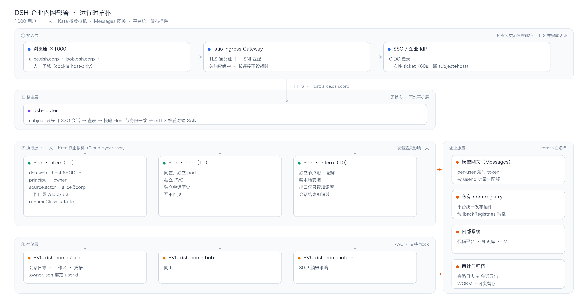
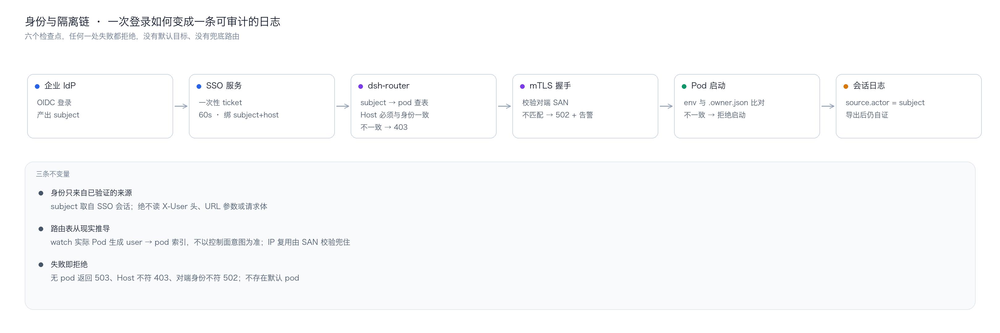

# DSH 企业内网部署清单

> 工作文档，不是产品文档。基于 `@deepseek-ai/dsh@0.2.1-alpha.4` 的当前行为编写。
> 目标：1000 用户，浏览器 + 本地安装双形态，一人一 pod（Kata），Messages 网关，平台统一发布插件。

## 0. 已定前提

| 项 | 决定 |
|---|---|
| 用户规模 | 1000 |
| 浏览器形态隔离 | Kata Containers + Cloud Hypervisor，一人一 pod 一 PVC |
| 模型网关 | Messages 兼容，`llm-deepseek` 的 `baseURL` 直连 |
| 本地安装 | 允许部分用户，Desktop/CLI + 同一网关 + 同一私有 registry |
| 插件治理 | 平台统一发布，用户不可安装 |

## 1. 架构



四层：接入（Istio + SSO）→ 路由（dsh-router）→ 执行（一人一 Kata 微虚拟机）→ 存储（一人一 PVC）。右侧为企业服务面，由 egress 白名单约束。



身份从 SSO 一直贯穿到会话日志，中间六个检查点任何一处失败都拒绝。

## 2. 先定死的命名约定

| 项 | 约定 | 理由 |
|---|---|---|
| `userId` | 企业邮箱小写，如 `alice@corp` | 全局唯一；标记文件用原值，label 用 @ 换成 _ 的形式 |
| 子域 | `alice.dsh.corp`（userId 本地部分） | cookie 是 host-only，必须一人一域 |
| PVC | `dsh-home-<sha256(userId)[0:12]>` | 避免非法字符与长度问题 |
| 标签 | `dsh.corp/user=<userId 的 @ 换成 _>`（`alice@corp` → `alice_corp`）、`dsh.corp/tier=<T0|T1|T2>` | 策略选择与审计 |
| 挂载点 | `/data/dsh` | 固定，写进镜像 entrypoint |

## 3. 镜像与进程

### 3.1 镜像

- [ ] 基础镜像固定 Node 版本（`^22.19 || >=24`）
- [ ] `npm i -g @deepseek-ai/dsh@0.2.1-alpha.4`（**锁死完整版本，禁止 range**）
- [ ] 镜像内不写任何凭据
- [ ] 版本号写进 pod 标签，便于灰度与回滚

### 3.2 RuntimeClass

- [ ] 节点池 `dsh-kvm` 开启 KVM，打污点 `dsh.corp/dedicated=dsh:NoSchedule`
- [ ] `RuntimeClass: kata-clh-runtime-rs`（Kata ≥ 4.0 默认的 Rust runtime + Cloud Hypervisor）
- [ ] 不用 `kata-fc`（无 virtio-fs，要每节点 devmapper thin-pool），也不用已弃用的 Go 版 `kata-clh`
- [ ] T0 实习生池单独一组节点，同 runtime，不同 nodeSelector

### 3.3 启动命令

**关键约束：`dsh web` 不接受 `0.0.0.0`，必须绑定具体网卡 IP。**

完整 entrypoint（含身份校验）见 4.4。这里只列必须满足的三条：

- [ ] `--host "$POD_IP"`，`POD_IP` 通过 downward API 注入：`fieldRef: status.podIP`
- [ ] `--no-open` 必须加，否则容器里会尝试拉起浏览器
- [ ] 不在 pod 内终止 TLS（理由见 5.4）

### 3.4 企业 profile

profile 目录：`$DSH_HOME/profiles/web/`，在镜像里预置 `cordis.patch.yml`。

- [ ] 关闭 HMR（Web 模板默认开启，生产不需要文件监听）
- [ ] 禁用 `plugin-manager`（它同时提供 Web 侧栏和 **agent 工具**，agent 能装任意包）
- [ ] 禁用 `plugin-market` 与 `plugin_market` 工具
- [ ] 模型：`baseURL` 指向内网网关
- [ ] 插件 registry：`registry: https://nexus.corp/repository/npm/`，`fallbackRegistries: []`
- [ ] 权限预设只保留 `workspace-write` 一类，不暴露 `danger-full-access`
- [ ] Session 持久化：`root` 已在 base 中为 `dshHomePath('sessions')`，随 `$DSH_HOME` 落到 PVC，**无需改**

### 3.5 健康信号

- [ ] liveness：`GET /`，宽松阈值（只证明进程活着）
- [ ] **readiness / 进展信号：不用 HTTP 探针**，由控制器读会话日志判断 `turn` 是否在推进
- [ ] 不要在 turn 进行中重启 pod

## 4. 多用户隔离（重点）

### 4.1 隔离在哪一层

DSH 的 `SessionHeader` **没有 userId 字段**，`ctx.sessions` 是进程内全局 Map。所以隔离**不靠 DSH**，靠下面四层：

| 层 | 保证 | 谁实现 |
|---|---|---|
| ① 路由 | subject → 这台 pod | 网关 |
| ② 挂载 | 这台 pod 只挂自己的卷 | K8s + provisioner |
| ③ 网络 | 只有网关能连 pod | NetworkPolicy |
| ④ 进程 | pod 内 principal 恒为 `owner` | DSH |

一条重要事实：会话 id 是进程内顺序生成的（`session-1`、`session-2`…），**可枚举**。DSH 从不依赖 id 不可猜。所以绝不能做"共享 pod + 按 id 过滤"。

### 4.2 存储：一人一 PVC

- [ ] 一人一个 PVC，`accessModes: ReadWriteOnce`
- [ ] `reclaimPolicy: Delete`（不是 Retain，避免卷被复用）
- [ ] 存储后端选支持 `flock` 的文件系统
  - `flock` 在 NFSv3 上不可靠，DSH 的跨进程单写者排他依赖它
  - RWO 由 K8s 保证单挂载点，可接受；如要 RWX 批量快速恢复，用 CephFS（支持 flock），**不要用 NFSv3**
- [ ] 卷加密（会话日志里是完整源代码）
- [ ] 备份：按策略快照，恢复时必须走 4.4 的标记校验

```yaml
apiVersion: v1
kind: PersistentVolumeClaim
metadata:
  name: dsh-home-a1b2c3d4e5f6
  namespace: dsh-users
  labels:
    dsh.corp/user: alice_corp
spec:
  accessModes: ["ReadWriteOnce"]
  storageClassName: ceph-rbd        # 或 cephfs（RWX，flock 可靠）
  resources:
    requests:
      storage: 30Gi
```

**不要用「共享大卷 + subPath」。** 底层文件系统仍然共享，快照与恢复互相影响，一次挂载配置错误就是全员暴露。1000 个能执行任意命令的用户，这个风险不能接受。

### 4.3 身份注入：身份来自 Pod 对象，不来自用户

K8s 里有个容易搞反的点：**用户身份不是「传进容器」的，而是控制面写进 Pod 对象的。** 用户从不接触 `kubectl`，所以 Pod spec 的每个字节都由控制面写入。

| 方式 | 写法 | 评价 |
|---|---|---|
| **Downward API 读注解** | `fieldRef: metadata.annotations['dsh.corp/principal']`（label 只用于归属与选择） | 推荐。身份只有 Pod 对象一处来源，不会出现 env 与 label 不一致 |
| Pod spec 写字面量 env | `value: alice@corp` | 能用，但多一份可能写错的副本 |
| ServiceAccount projected token | `serviceAccountToken` | 密码学可验证，但 DSH 用不上——认证在网关做 |
| 用户自己提供 | — | **绝对不要**。DSH 的 `principalOf()` 拒绝从 wire 数据读身份，同理 |

**环境变量本身不证明任何事**，它只是控制面的「意图」。能证明「这个卷属于这个人」的是卷上的标记文件。两者交叉校验才有意义。

```yaml
apiVersion: apps/v1
kind: Deployment
metadata:
  name: dsh-alice
  namespace: dsh-users
  labels: { dsh.corp/user: alice_corp }
spec:
  replicas: 1
  strategy:
    type: Recreate                    # RWO 卷必须 Recreate，否则滚动更新卡在 Multi-Attach
  selector:
    matchLabels: { dsh.corp/user: alice_corp }
  template:
    metadata:
      labels:
        dsh.corp/user: alice_corp
        dsh.corp/tier: T1
      annotations:
        dsh.corp/public-host: alice.dsh.corp
    spec:
      runtimeClassName: kata-clh-runtime-rs
      serviceAccountName: dsh-workload   # 无 RBAC 权限，仅身份占位
      securityContext:
        runAsNonRoot: true
        runAsUser: 1000
        fsGroup: 1000                    # 不设会让非 root 容器写不进卷
      tolerations:
        - key: node.kubernetes.io/unreachable
          operator: Exists
          effect: NoExecute
          tolerationSeconds: 30
        - key: node.kubernetes.io/not-ready
          operator: Exists
          effect: NoExecute
          tolerationSeconds: 30
        - key: dsh.corp/dedicated
          operator: Equal
          value: dsh
          effect: NoSchedule
      initContainers:
        - name: init-home
          image: registry.corp/dsh:0.2.1-alpha.4
          command: ["/opt/dsh/init-home.sh"]
          env:
            - name: DSH_USER_ID
              valueFrom:
                fieldRef: { fieldPath: "metadata.annotations['dsh.corp/principal']" }
          volumeMounts:
            - { name: home, mountPath: /data/dsh }
      containers:
        - name: dsh
          image: registry.corp/dsh:0.2.1-alpha.4
          command: ["/opt/dsh/entrypoint.sh"]
          env:
            - name: DSH_HOME
              value: /data/dsh
            - name: DSH_USER_ID
              valueFrom:
                fieldRef: { fieldPath: "metadata.annotations['dsh.corp/principal']" }
            - name: DSH_LABEL
              valueFrom:
                fieldRef: { fieldPath: "metadata.labels['dsh.corp/user']" }
            - name: POD_IP
              valueFrom:
                fieldRef: { fieldPath: "status.podIP" }
            - name: DSH_PUBLIC_HOST
              valueFrom:
                fieldRef: { fieldPath: "metadata.annotations['dsh.corp/public-host']" }
            - name: DEEPSEEK_API_KEY
              valueFrom:
                secretKeyRef: { name: dsh-model-token-alice, key: token }
          volumeMounts:
            - { name: home, mountPath: /data/dsh }
          ports:
            - { containerPort: 8080 }
      volumes:
        - name: home
          persistentVolumeClaim:
            claimName: dsh-home-a1b2c3d4e5f6
```

### 4.4 owner marker：挡住挂错卷、恢复错位、复用未清

标记路径：`/data/dsh/.owner.json`

```json
{ "userId": "alice@corp", "tenantId": "t-001", "issuedAt": "2026-11-12T00:00:00Z" }
```

**`init-home.sh`** —— 只在空卷上写标记，绝不覆盖：

```sh
#!/bin/sh
set -eu
MARKER=/data/dsh/.owner.json
: "${DSH_USER_ID:?DSH_USER_ID is required}"

if [ -s "$MARKER" ]; then
  exit 0                                  # 已有标记，交给主容器校验
fi

if [ -n "$(ls -A /data/dsh 2>/dev/null)" ]; then
  echo "volume is not empty but has no owner marker" >&2
  exit 1                                  # 有数据却没标记：可疑，拒绝
fi

cat > "$MARKER" <<EOF
{"userId":"$DSH_USER_ID","issuedAt":"$(date -u +%FT%TZ)"}
EOF
```

**`entrypoint.sh`** —— 交叉校验，失败即退出：

```sh
#!/bin/sh
set -eu
: "${DSH_USER_ID:?}" "${POD_IP:?}" "${DSH_PUBLIC_HOST:?}"

ACTUAL=$(sed -n 's/.*"userId":"\([^"]*\)".*/\1/p' /data/dsh/.owner.json)
[ "$DSH_USER_ID" = "$ACTUAL" ] || {
  echo "owner mismatch: pod says '$DSH_USER_ID', volume says '$ACTUAL'" >&2
  exit 1
}

exec dsh web \
  --host "$POD_IP" --port 8080 --no-open \
  --public-url "https://${DSH_PUBLIC_HOST}" \
  --trusted-host "$DSH_PUBLIC_HOST"
```

- [ ] 不匹配**拒绝启动**（fail closed），不是「先跑起来」
- [ ] `--host` 用 `$POD_IP`，不是 `0.0.0.0`（DSH 拒绝通配地址）
- [ ] 卷回收时删除 `.owner.json` 之外的全部内容，再写新标记

### 4.5 准入控制：让「挂错」根本发生不了

运行时校验是兜底。更好的做法是在准入阶段就拒绝不一致的 Pod：

```yaml
apiVersion: admissionregistration.k8s.io/v1
kind: ValidatingAdmissionPolicy
metadata:
  name: dsh-pvc-user-match
spec:
  failurePolicy: Fail
  matchConstraints:
    resourceRules:
      - apiGroups: [""]
        apiVersions: ["v1"]
        operations: ["CREATE", "UPDATE"]
        resources: ["pods"]
  variables:
    - name: claim
      expression: "object.metadata.?annotations['dsh.corp/home-claim'].orValue('')"
  validations:
    - expression: |
        object.metadata.?labels['dsh.corp/user'].orValue('') != '' &&
        variables.claim.startsWith('dsh-home-') &&
        object.spec.volumes.all(v,
          !has(v.persistentVolumeClaim) ||
          v.persistentVolumeClaim.claimName == variables.claim)
      message: "pod 必须带 dsh.corp/user 标签，且挂载的 PVC 等于 dsh.corp/home-claim"
```

- [ ] 终端用户**没有任何 `pods` / `pvc` 权限**；只有控制面的 ServiceAccount 能创建
- [ ] 准入策略 `failurePolicy: Fail`，不要用 `Ignore`
- [ ] 策略本身纳入发布流水线，与应用一起版本化

### 4.6 网络

- [ ] 默认拒绝的 NetworkPolicy
- [ ] 只放通：模型网关、私有 registry、内部系统域名、DNS
- [ ] 禁公网出口
- [ ] 阻断云元数据地址 `169.254.169.254`（沙箱逃逸后仍能打）
- [ ] pod 之间禁止互访（除网关）
- [ ] 禁 `hostNetwork` / `hostPath` / `privileged`

### 4.7 隔离验收

- [ ] 用 Alice 的浏览器访问 `bob.dsh.corp` → 403
- [ ] 把 Alice 的 PVC 挂到 Bob 的 pod → **准入阶段被拒**；绕过准入直接改 Deployment 时，容器启动失败并报 owner mismatch
- [ ] 两个浏览器 cookie 互换 → 各自失效
- [ ] 离职用户卷回收后，新用户首次登录 → 工作区与会话均为空
- [ ] Pod 上没有 `dsh.corp/user` 标签时 → 容器拒绝启动（不是以空身份跑起来）

## 5. 路由（重点）

### 5.1 DNS 与证书

- [ ] 通配 DNS：`*.dsh.corp` → 网关
- [ ] 通配证书：`*.dsh.corp`
- [ ] 不要用路径前缀路由（`/u/alice/`）。DSH 的 cookie 是 **host-only、Path=/**，同一 host 下所有用户共享 cookie 命名空间，会串号

### 5.2 网关职责

| 职责 | 说明 |
|---|---|
| SSO | OIDC 登录，拿到 `subject` |
| 路由 | `subject` → 用户记录 → pod。**不由请求的 Host 决定** |
| 一致性校验 | 请求 Host 与 `subject` 对应的子域不一致 → 403 |
| DSH 认证 | 持有每 pod 的 DSH cookie（方式 B，见 5.3.3） |
| WS 代理 | `/api/remote.mux` 等 WebSocket 升级 |
| 审计 | 记录 `subject`、pod、时间、动作 |

**最关键的一条：路由必须由 SSO subject 决定。** 如果按 Host 路由，Alice 手输 `bob.dsh.corp`、通过 SSO 后会被送到 Bob 的 pod，而她在那个 pod 里就是 `owner`——直接看到 Bob 的全部会话。

### 5.3 登录与认证：DSH 里没有可拦截的"登录"

#### 5.3.1 三个拦截点，全在 Connection 内部，不可插拔

| 顺序 | 位置 | 作用 | 失败 |
|---|---|---|---|
| 1 | [`api-request-trust.ts`](packages/client/connection/src/api-request-trust.ts) | Host / Origin / `sec-fetch-site` 校验，**不是身份认证** | 403 |
| 2 | [`browser-auth.ts:263`](packages/client/connection/src/browser-auth.ts:263) `authorizeIndex` | 只认 `GET /?token=<进程令牌>`，换成签名 cookie，303 到 `./` | 401 |
| 3 | [`browser-auth.ts:302`](packages/client/connection/src/browser-auth.ts:302) `isAuthenticated` | 验 authority 绑定的签名 cookie | 401 |

真正的门只有第 3 道。三者都没有 hook，也没有"关闭认证"的配置项。

- [ ] 不要指望"在 DSH 里挂一个登录插件"——那里没有登录，只有令牌换 cookie
- [ ] 认证只能在 DSH **前面**做（网关），或**改 Connection**

#### 5.3.2 硬约束：cookie 是 host-only，跳转必须落到目标子域自己

`sso.corp` 无法为 `alice.dsh.corp` 设置 cookie。只有从 `alice.dsh.corp` 返回的响应才能种。

DSH 唯一承认的入口是：

```
GET https://alice.dsh.corp/?token=<该 pod 的 launch token>
```

**跳转 URL 不带 token = 落地即 401。**

另一个事实：`launchToken` 来自 `processLaunchToken(processOwner)`，**不是一次性**——进程生命周期内一直有效，代码里没有"用过即失效"。

#### 5.3.3 三种落地方式

| | A 带 token 跳转 | B 票据 + 网关代理 | C 改 Connection |
|---|---|---|---|
| 认证服务 | 独立 SSO 服务 | 独立 SSO 服务 | 独立 SSO 服务 |
| DSH 改动 | 无 | 无 | 小 |
| token 暴露给浏览器 | **是** | 否 | 否 |
| 可吊销 | 只能等 pod 重启 | 可以 | 可以 |
| 用户身份进会话日志 | 否 | 否 | **是** |
| 适合 | P0 验证 | 仅 C 延期时的临时手段 | P1 正式方案，取代 A/B |

**方式 A：认证成功后 302 到带 token 的地址**

```
浏览器 → alice.dsh.corp（无 cookie）
      → 302 sso.dsh.corp/login?return=https://alice.dsh.corp/
SSO   → IdP 认证成功 → 向控制面要 alice 的 pod launch token
      → 302 https://alice.dsh.corp/?token=<token>
DSH   → 校验 → Set-Cookie → 303 到 ./（referrer-policy: no-referrer）
```

- [ ] 仅用于 P0 验证
- [ ] 必须接受：token 会进浏览器地址栏与本地历史，等价于该 pod 的完整工具权限

**方式 B：认证服务发票据，网关校验后代理（推荐 P1）**

```
浏览器 → https://alice.dsh.corp/                     无 cookie
网关   → 302 https://sso.dsh.corp/login?return=...
SSO    → 企业 IdP 认证 → 校验 return 在白名单
       → 302 https://alice.dsh.corp/_auth/callback?ticket=<一次性 60s，绑 subject+host>
网关   → 验 ticket（本地验签或回调 SSO）
       → 查 subject → pod，并校验请求 Host 与 subject 归属一致
       → 从控制面取该 pod 的 launch token
       → 内部 GET http://<pod-ip>:8080/?token=...       Host: alice.dsh.corp
DSH    → 303 + Set-Cookie
网关   → 保存该 DSH cookie；给浏览器种自己 host-only 的会话 cookie
       → 之后每个请求由网关带 DSH cookie 转发
```

- [ ] launch token 从不出集群，浏览器只见网关自己的会话 cookie
- [ ] 可按会话吊销，可携带 subject 做审计

> 参考实现多了一层登录页：无会话的浏览器导航先到 `/_dsh/login`，点按钮才跳 SSO；
> 设 `LOGIN_MODE=direct` 可恢复上面的直跳。等待页同理，只影响浏览器导航，接口客户端仍是 503。

**方式 C：给 Connection 加受信前置认证（P1 必须做，见 6.1）**

在 `authorizeIndex` 之前判断：来自受信网关（mTLS 客户端证书 + SAN 校验）的请求视为已认证，直接构造 `Peer({ principal: owner, actor })`。

C 落地后 A 与 B 都不再需要。

- [ ] 唯一能让真实用户身份进入 `source.principal` 的方案
- [ ] 需要一次核心改动 + 配套测试

> **C 取代 B，不要叠加。** C 一旦落地，网关直接以受信身份连 pod，launch token 交换、票据、cookie 代理这一整套都不再需要。
>
> 排期：P0 用 A 做小范围链路验证（不改 DSH）；P1 直接做 C 并上线浏览器形态。B 只在"C 的评审卡住但必须提前放量"时作为临时手段。
>
> C 的安全前提：信任锚必须是 **mTLS 客户端证书 + SAN 校验**（或等同强度的机制），不能只凭一个 HTTP 头——否则 pod 网络内任何进程都能冒充网关，直接拿到 `owner`。

#### 5.3.4 四道必须的校验

- [ ] **`return` 白名单**：只允许 `*.dsh.corp`，且与 subject 归属一致——否则是开放重定向；配合方式 A 还能把 token 送到攻击者域名
- [ ] **ticket 一次性 + 短时效**（≤60 s）+ 绑定 subject 与目标 host
- [ ] **Host 与 subject 一致性**：`bob.dsh.corp` + Alice 身份 → 403。少了这条，Alice 能进 Bob 的 pod，而在那里她是 `owner`
- [ ] **token 分发通道受控**：控制面持有 `userId → {podIP, launchToken, tokenVersion}`，pod 重启即失效重取；不要让认证服务去读 `kubectl logs`

#### 5.3.5 token 生命周期与"全员登出"

- `launchToken` 随 pod 重启而变，但 DSH 的签名密钥持久化在 `$DSH_HOME/.credentials.yaml`（PVC 上），cookie 有效期 30 天
- 所以 **pod 重启通常不需要重新交换 token**，旧 cookie 仍有效
- 唯一的全局吊销开关：替换或删除 `.credentials.yaml` 里的 `client-connection/browser-session` 记录 → 所有 DSH cookie 同时失效 → 全部用户需重新走一次登录

- [ ] 把"删除该记录 + 重启"写进应急预案（这是 DSH 仅有的登出手段）
- [ ] 定期轮换该密钥，并配套安排用户的重新登录

### 5.4 Cookie 与 Secure

- cookie 名与签名载荷绑定 `hostname:port`（HTTPS 还绑定 `https:` scheme）
- `host-only`、`Path=/`、`HttpOnly`、`SameSite=Strict`
- **`Secure` 只取决于接收 index 请求的监听器是否走 TLS**，不看 `public-url`，也不看 `X-Forwarded-Proto`

所以如果网关终止 TLS、pod 内是 HTTP：cookie **不带 Secure**。

- 采用方式 B 时：cookie 只在集群内网关↔pod 之间传递，风险收敛在集群内网 → 可接受
- 若坚持 pod 内 TLS：用内部 CA 签 `alice.dsh.corp`，`--tls-cert/--tls-key` 起 HTTPS → cookie 带 Secure，但每用户证书管理成本高

**不要**把 DSH 的 cookie 透传给浏览器——那会把一个非 Secure 的凭据暴露到公网路径上。

### 5.5 超时与代理细节

- [ ] WebSocket 升级代理（长连接）
- [ ] 关闭响应缓冲/压缩（流式输出会被破坏）
- [ ] 读超时 ≥ 10 分钟（一个 turn 可能跑很久）
- [ ] 请求体上限按文件上传需要放大
- [ ] 不要注入会改变 `Origin` 的改写（信任校验会比较 Origin 与 Host）

### 5.6 路由与认证验收

- [ ] `alice.dsh.corp` 只能到 Alice 的 pod（看 pod 日志里的 session 创建记录）
- [ ] 手输 `bob.dsh.corp` 用 Alice 的账号 → 403
- [ ] 篡改 `return` 为外部域名（如 `https://evil.example`）→ 拒绝，不跳转
- [ ] 重放一个已用过的 ticket → 拒绝
- [ ] 未带 cookie 直接访问 `https://alice.dsh.corp/` → 走 SSO，而不是停在 401
- [ ] pod 重启后，用户刷新页面能自动重新登录，不需要人工介入
- [ ] WebSocket 在网关后能建立并保持 10 分钟以上
- [ ] 流式输出不出现整段卡住再一起出现
- [ ] 浏览器开发者工具里**看不到 launch token**，也看不到 DSH 的 cookie（方式 B）

## 6. 身份与权限

- [ ] IdP：OIDC 接入，组信息随 token 或 SCIM 同步
- [ ] tier 矩阵：`T0 实习生` / `T1 正式` / `T2 特权`，每档一个 profile + nodeSelector + 出口策略
- [ ] **模型凭据 per-user**：容器启动时用 SSO 换短时网关 token，写进容器内 credential store；不要全员共用一个 API key
- [ ] 配额：网关侧按 `userId` 计量 + `token-meter` 会话级估算
- [ ] T0：账号带到期时间、禁本地安装、容器结束即销毁、模型档位更低

### 6.1 审计归因：能查到"某个用户在某一轮说了什么"

**这是硬要求，因此认证方式 C 不是 P2 可选项，必须提前到 P1。**

#### 两个层次，别混为一谈

| | 合规审计 | 取证自证 |
|---|---|---|
| 目标 | 不可篡改、集中留存、可检索 | 日志自带身份，导出/迁移后仍成立 |
| 实现 | 网关旁路记录 | 会话日志内 `source.actor` |
| 覆盖 | 只覆盖经过网关的流量 | 覆盖所有来源与形态 |
| 篡改风险 | 低（独立系统，agent 碰不到） | 中（日志在用户卷上） |

两者互补，多数企业都要。

#### 为什么旁路不够

- [ ] 本地安装形态**不走网关**，旁路审计覆盖不到；而本地安装恰好是数据落个人机器、风险更高的一类
- [ ] 旁路看不到 pod 内产生的轮次（定时提醒、webhook 触发、subagent）
- [ ] 会话导出、归档、跨集群迁移后，外部关联表可能缺失，归因断裂

结论：**旁路做合规，就地归因做取证，两者都上。**

#### DSH 侧改动（一次性，约 1–2 周）

1. **`PeerScope` 增加 `actor?`**，与 `principal` 正交
   - **关键：不要把用户做成非 owner 的 principal。** 那会触发 `remote-access` 的整条链路，而它有已知缺口（非 owner 的 exact Fetch 路由一律 403；未在 `@Remote({ resources })` 声明的资源不做检查）。authorization 保持 `owner`，身份单独走 `actor`
2. **`user/message` 的 `source` 增加 `actor?`**
   - 属于持久化类型变更：需要 `docs/persistence-changes/` 确认记录 + catalog 重新生成 + 双 SDK 快照同步
   - 可选字段，`SESSION_FORMAT_VERSION` 不变——参照 `2026-10-13-user-rpc-principal` 的先例
   - **不进入模型请求**：身份是审计元数据，不应泄漏给模型
3. **Connection 增加受信前置认证入口**（网关 mTLS + 签名头），把 `subject` 填进 `actor`
4. **本地安装**：SSO 凭据插件把 `subject` 写进 `actor`

#### 覆盖矩阵

| 来源 | actor |
|---|---|
| 浏览器人类输入 | 网关注入的 `subject` |
| 本地安装人类输入 | SSO 插件注入的 `subject` |
| 定时提醒、goal 续跑 | 缺省（系统生成） |
| webhook 触发 | 规则发起人 |
| subagent 子会话 | 继承父会话的 actor，或标记为 agent 生成 |

#### 验收

- [ ] 导出任意会话，每条 user message 都带 actor，**不依赖外部关联表**
- [ ] 本地安装产生的会话同样带 actor
- [ ] actor 不出现在模型请求里（抓一次请求头与 body 确认）
- [ ] 抽查一轮：能从 `sessionId + seq` 直接还原到人和原文

## 7. 控制面与空闲回收

### 7.1 状态机

```
Absent ──登录──► Provisioning ──就绪──► Running
                                          │
                     openTurn=true ───────┤ 不回收
                     idle > 15min ────► Sleeping ──访问──► Provisioning
                     idle > 90d  ────► Archived
                     离职        ────► Deleted
```

### 7.2 判据只有一个硬守卫

**没有 open turn 才允许回收。** 其余阈值都只是延迟。

| 信号 | 为什么不能用 |
|---|---|
| HTTP 连接数 | 浏览器关了但 turn 还在跑 → 误杀；后台标签页挂一天 → 永不回收 |
| CPU 使用率 | 等模型返回时 CPU 为 0，但 turn 开着 → 误杀 |
| 日志 mtime | 20 分钟的测试执行期间日志不增长 → 误判空闲 |

信号由 DSH 插件提供（`plugin/`），它监听 `turn/start` / `turn/end` 并上报。

### 7.3 回收梯度

| 级别 | 条件 | 动作 | 恢复 |
|---|---|---|---|
| L0 活跃 | `openTurn=true` | 任何阈值都不碰 | — |
| L1 休眠 | 无 open turn 且静默 > 15 min | Deployment 缩 0，**保留 PVC** | 冷启动 5–15s + resume |
| L2 归档 | L1 持续 90 天 | PVC 快照到对象存储后删除 | restore，分钟级 |
| L3 清除 | 离职 / T0 到期 | 删 Deployment + PVC + 快照 | 不可恢复 |

T0（实习生）单独一列：L1 阈值 10 分钟，L2 阈值 7 天，离职立即 L3。

### 7.4 控制面契约

`Record` 必须同时表达「路由」与「期望状态」，否则缩容后就分不清「没有这个用户」和「用户存在但在睡觉」：

```go
type Record struct {
    Handle         string // K8s 标签值（@ 换成 _，如 alice_corp）
    Subject        string // 规范身份（alice@corp）
    PublicHost     string
    PodIP          string
    PrincipalURI   string
    LaunchToken    string
    DesiredState   string // running | sleeping | archived
    OpenTurn       bool
    LastActivityAt int64
}
```

- [ ] `lookup` 命中但 `desiredState != running` → router 触发唤醒并返回 503 + `Retry-After`
- [ ] 查不到 → 404（真的没这个用户）
- [ ] 记录持久化在 Postgres（`control/store.go` + `control/schema.sql`），控制面本身无状态可水平扩
- [ ] 回收器是唯一执行 scale 的组件，路由与业务不碰 K8s

### 7.5 其余约束

- [ ] 首次登录按需创建（卷 + pod），不要预创建 1000 个（当前实现：管理员在 `/_dsh/admin` 显式开通，见 `docs/add-user.md`）
- [ ] 单用户单 Active pod（防 split brain；`flock` 会让第二个写者报 `SessionAlreadyOwnedError`，是错误而不是损坏）
- [ ] 升级：分批 + 空闲检测 + 前端提示，不要在高峰期滚动

### 7.6 成本

1000 用户、人均日活跃 40 分钟 + 15 分钟滞留：常驻 24,000 pod 小时/天，15 分钟回收后约 920。**约 26 倍差距——回收策略是这套架构最大的成本杠杆，不是微虚拟机。**

## 8. 观测

- [ ] 网关侧：请求量、延迟、401/403 计数（401 突然升高通常是 cookie 失效）
- [ ] pod 侧：会话数、turn 时长、`token-meter` 上下文压力
- [ ] 存储：卷使用率、写入延迟、`flock` 失败计数
- [ ] 恢复指标：从故障到会话可用的 P50/P95
- [ ] 审计：`subject` / pod / 时间 / 动作，汇总到一处

## 9. 容量起步假设

| 项 | 假设 | 结果 |
|---|---|---|
| 峰值并发 | 15% | ~150 |
| 含余量 | ×1.3 | ~200 |
| 单 pod | 2 vCPU / 4 GB | 400 vCPU / 800 GB |
| 节点 | 64 vCPU / 256 GB | 8–12 台 |
| 卷 | 30 GB/人 精简置备 | 上限 ~30 TB |

模型成本是大头，配额必须在 P1 就上。

## 10. 分期

| 阶段 | 范围 | 出口标准 |
|---|---|---|
| P0 | 本地安装：私有 registry + 企业 profile + SSO 凭据插件 + 内网网关 | 20 人可用，插件不可私装 |
| P1 | 浏览器：Kata + 一人一卷 + 子域路由 + **方式 C（受信前置认证 + 就地归因）** | 50 人试点，4.7、5.6、6.1 全绿 |
| P2 | 扩到 1000：回收、配额、旁路审计聚合、多集群 | 恢复 SLO 达标，审计可追溯 |

## 11. 风险登记

| 风险 | 严重度 | 缓解 |
|---|---|---|
| 路径路由导致 cookie 串号 | 极高 | 强制子域 |
| 网关按 Host 路由导致越权 | 极高 | 按 subject 路由 + 一致性校验 |
| `return` 未做白名单导致开放重定向 | 极高 | 只允许 `*.dsh.corp` 且与 subject 归属一致 |
| 方式 A 把 launch token 暴露给浏览器 | 高 | 仅在 P0 使用；P1 起换方式 B |
| `plugin-manager` 未禁用 | 高 | 企业 profile 显式禁用 |
| 共用模型 API key | 高 | per-user token |
| 身份到不了会话日志（审计断链） | 高 | 方式 C 进 P1，见 6.1 |
| launch token 抓取失效 | 中 | 认证方式 C 替换（不依赖 token） |
| `flock` 在网络文件系统上失效 | 中 | RWO 或 CephFS |
| NFSv3 上出现双写 | 中 | 存储选型时排除 |
| 活跃 turn 被回收 | 中 | 按会话活动判空闲 |
| 卷未加密 | 中 | 存储层加密 |
| 插件版本漂移（多集群） | 中 | 单一来源 + 发布编排 |

## 12. 上线前必须跑通的三件事

1. **杀掉一个正在跑工具的 pod 的节点**，确认恢复后会话标为 interrupted、且没有重复执行有副作用的工具。
2. **用 Alice 的账号访问 Bob 的子域**，必须 403；再把 Alice 的卷挂到 Bob 的 pod，必须启动失败。
3. **导出 Alice 的一个会话**，确认每条 user message 都带 actor，且不依赖任何外部关联表。

这三条同时验证了会话恢复、路由隔离、存储隔离和审计归因四个机制。

## 13. 可执行清单

全部 YAML、脚本与服务源码在 [dsh-enterprise-deploy/](dsh-enterprise-deploy/)：

```
dsh-enterprise-deploy/
├── README.md                执行顺序与每步的验证命令
├── Makefile                 按目标执行（base / certs / control / router / istio / user / verify）
├── 01..14 *.yaml            集群侧清单（01 命名空间 … 09 Postgres … 14 用户示例）
├── image/                  用户 pod 镜像：Dockerfile + init-home.sh + entrypoint.sh + 企业 profile
├── router/                 路由服务（Go）
├── control/                控制面（Go + Postgres：store.go / schema.sql）
├── provision.py            开通 CLI（调 control 的 /internal/provision）
└── verify.sh               隔离验收
```

验证状态：

- `router` 与 `control` 已在本机 Go 1.27 编译通过 `go build` / `go vet`；`control` 的 Postgres 访问用本地 pgx stub 做类型检查（沙箱无法访问 Go 模块代理），首次构建前需在有网环境执行 `go mod tidy` 生成 `go.sum`。
- 全部 YAML 已通过语法解析，但未在真实集群上 `--dry-run=server`；`ValidatingAdmissionPolicy` 的 CEL 需要 1.30+ 集群首次 apply 验证。

